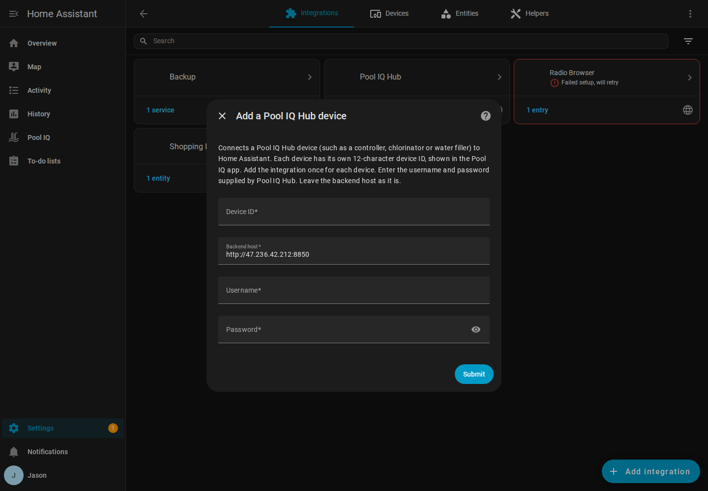
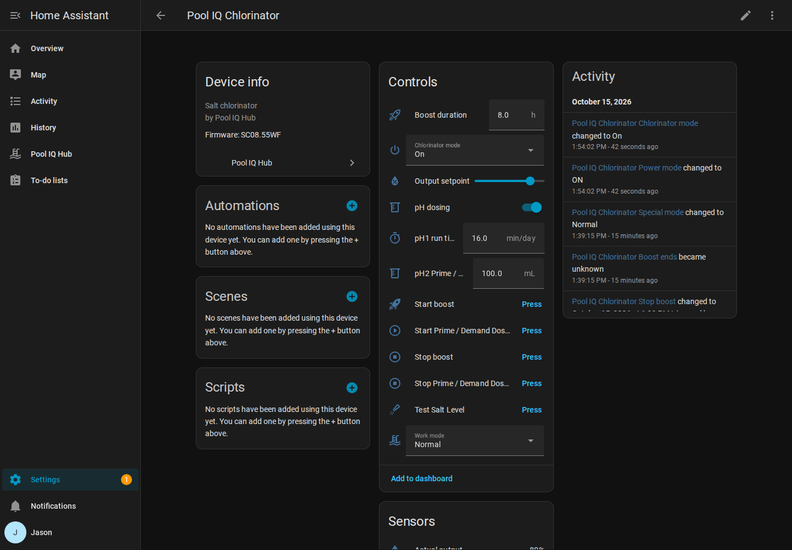

# Pool IQ Hub for Home Assistant: Installation and Setup

This guide takes a fresh Home Assistant installation to a working Pool IQ setup. It takes about 10 minutes.

## What you need

- Home Assistant 2024.7 or newer (tested on 2026.2)
- A Pool IQ hub that is online and working in the Pool IQ app
- The **device ID** of each Pool IQ Hub device: a 12-character code such as `0070XXXXXXXX`, shown in the Pool IQ app
- The Pool IQ **username and password** supplied by Pool IQ Hub

## Step 1: Copy the integration into Home Assistant

You need to put the `pooliq` folder from this package into Home Assistant's `config/custom_components/` folder. Choose one method.

**Option A: HACS (recommended)**

If HACS isn't installed yet, follow the official guide at https://hacs.xyz/docs/use/ first.

1. In Home Assistant, open **HACS** from the sidebar.
2. Click the three-dot menu (top right) and choose **Custom repositories**.
3. In **Repository**, paste: `https://github.com/JaseznBrandio/pooliqhub`
4. In **Type**, choose **Integration**, then click **Add**.
5. Close the dialog, search HACS for **Pool IQ**, open it and click **Download**.

**Option B: Manual copy**

1. Install the **File editor** or **Samba share** add-on (Settings → Add-ons → Add-on store), or use SSH.
2. Open the `config` folder. Create a folder called `custom_components` if it doesn't exist.
3. Copy the `pooliq` folder from this package into it, so you have `config/custom_components/pooliq/manifest.json`.

## Step 2: Restart Home Assistant

Go to **Settings → System → Restart** (top right) → **Restart Home Assistant**. A custom integration is only detected after a restart.

## Step 3: Add the integration

1. Go to **Settings → Devices & services**.
2. Click **Add integration** (bottom right) and search for **Pool IQ**.
3. Enter the **device ID**, plus the **username** and **password** supplied by Pool IQ Hub.
4. Leave **Backend host** as it is, and click **Submit**.



If you see "Login was rejected", check the username and password. If you see "Could not reach the Pool IQ backend", check that Home Assistant has internet access and that the hub shows as online in the Pool IQ app.

## Step 4: What you'll see

### Pool IQ in the sidebar

A **Pool IQ** item appears in the left sidebar. It shows:

- Pool and spa temperatures
- Salt level, chlorinator output, cell status, chlorinator pump and fault status
- Every socket connected to the hub (pumps, lights, blowers) with an on/off toggle and an **On / Off / Auto** selector. Auto returns the socket to its timer, which is shown underneath.

It follows the Home Assistant light or dark theme and works on phones.


To hide the sidebar item, go to **Settings → Devices & services → Pool IQ → Configure** and untick **Show Pool IQ in the sidebar**.

### Device page

**Settings → Devices & services → Pool IQ → Pool IQ Controller** (or **Pool IQ Chlorinator**) shows the standard Home Assistant device page: socket switches under **Controls**, readings under **Sensors**, and On/Off/Auto modes under **Configuration**. Click **Add to dashboard** to put these on any dashboard.



### Entities

| Type | Examples |
|---|---|
| Switch (one per socket) | Filter Pump, Pool Light, Spa Light, Blower, Jet Pump |
| Select (one per socket) | On / Off / Auto mode |
| Sensor | Pool temperature, Spa temperature, Salt level, Chlorinator output, Cell status, Fault code |
| Binary sensor | Chlorinator pump |

Socket names come from the names set in the Pool IQ app. Sockets with the same name get the socket number added, e.g. "Blower (socket 4)". Rename anything in Home Assistant by opening the entity and clicking the settings cog.

### More than one Pool IQ device

Each Pool IQ Hub device (controller hub, chlorinator and so on) has its own device ID. Add the integration once per device (**Add integration → Pool IQ** again, with the other device ID). Both appear on the same Pool IQ sidebar page. A chlorinator gets a **Chlorinator** section with mode, output setpoint, winter and spa modes, pH dosing, boost and salt test.

## Step 5 (optional): Automations

Because each socket is a normal Home Assistant switch, you can use it in automations. For example, turn the pool light on at sunset:

```yaml
automation:
  - alias: Pool light at sunset
    triggers:
      - trigger: sun
        event: sunset
    actions:
      - action: switch.turn_on
        target:
          entity_id: switch.pool_iq_chlorinator_pool_light
```

## Troubleshooting

| Problem | Fix |
|---|---|
| HACS says "Repository structure is not compliant" | Make sure you pasted the repository URL exactly, and chose type **Integration**. |
| Pool IQ doesn't appear in **Add integration** | Check the folder path is `config/custom_components/pooliq/` and restart Home Assistant. |
| A socket is missing | Toggle that socket once in the Pool IQ app. It appears within 5 minutes. |
| Values show "Unavailable" | The hub or the Pool IQ cloud is offline. Check the Pool IQ app. |
| Changes take a few seconds | Commands go through the Pool IQ cloud to the device, and the panel waits for its confirmation. A chlorinator purges for about 15 seconds before the cell turns on; Home Assistant follows it through. |
| Polling interval | Default is every 5 minutes. Change it under **Pool IQ → Configure**. |

For detailed logs, add this to `configuration.yaml` and restart:

```yaml
logger:
  logs:
    custom_components.pooliq: debug
```

## Updating

Replace the `config/custom_components/pooliq` folder with the new version (or click **Update** in HACS), then restart Home Assistant. Your settings and entity names are kept.

## Removing

**Settings → Devices & services → Pool IQ → three-dot menu → Delete**, then delete the `config/custom_components/pooliq` folder and restart.
