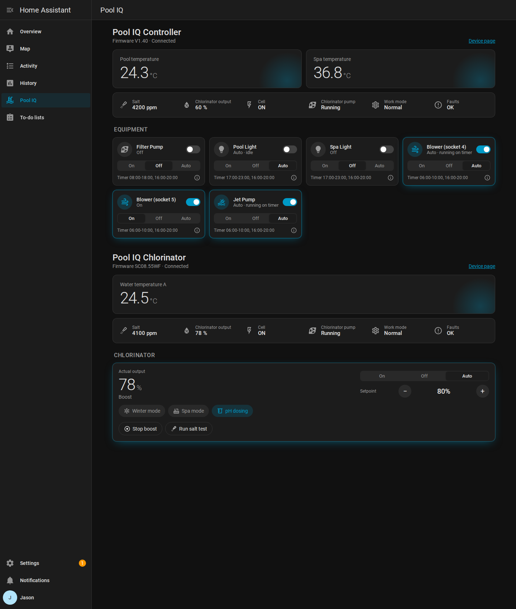

# Pool IQ Hub for Home Assistant

A custom integration that brings your Pool IQ Hub devices into Home Assistant. A controller hub gives you water temperatures and on/off/auto control of everything plugged into it (filter pump, lights, blowers, jet pump). A salt chlorinator gives you salt level, output, cell status, power pack temperature and full chlorinator control. Other Pool IQ Hub devices appear with the readings they report.

The Pool IQ app has no official Home Assistant integration. This talks to the same JetLinks cloud backend the app uses (`47.236.42.212:8850`), logging in with Pool IQ cloud credentials and reading each device's latest reported values on a schedule. After you change something, it checks back every few seconds until the device has settled.

> **New installing this?** See [INSTALL.md](INSTALL.md) for a step-by-step guide with screenshots.

## Pool IQ sidebar panel

After setup, a **Pool IQ** item appears in the Home Assistant sidebar: a ready-made control panel with pool and spa temperatures, chlorinator status, and every socket with an on/off toggle and an On/Off/Auto selector. It follows your light/dark theme and works on mobile. No dashboard editing required.



Turn it off under **Pool IQ → Configure → Show Pool IQ in the sidebar** if you'd rather build your own dashboard.

## Entities

### Socket control

Every socket the controller hub reports gets two entities, named from the names set in the Pool IQ app (e.g. Pool Light, Blower, Jet Pump):

- **Switch**: on forces the socket on, off forces it off.
- **Mode select** (On / Off / Auto): Auto hands the socket back to its built-in timer, the same as "off" in the Pool IQ app.

In Auto, the switch shows whether the timer currently has the socket on. The timer windows are shown as attributes. Sockets appear once the hub has reported them; if one is missing after setup, toggle it once in the Pool IQ app and it will show up within a polling interval.

### Chlorinator control

When the device is a salt chlorinator (it reports an output setpoint), it gets:

- **Chlorinator mode** (On / Off / Auto) and an **Output setpoint** slider (0 to 100%) for the active mode
- **Mode** (Normal / Winter / Spa), with the output control adjusting the setting for the active mode
- **pH dosing** switch, with pH pump run time and dose settings
- **Start boost** / **Stop boost** buttons, with a **Boost duration** setting (hours)
- **Run salt test** button
- **Special mode** (Normal, Boost, Backwash, Salt test), **Running on** (which timer is active), and **Timer 1 / Timer 2** windows
- **Power pack temperature** (°C)
- **Salt test result** (ppm): the figure the unit and the Pool IQ app show at the end of a salt test. **Salt level** is the unit's separate live reading, so the two can differ slightly.
- **Fault**: the fault in plain words (for example "Low flow"), or "Code N" for codes not yet known. The raw number is in the **Fault code** sensor.

Backwash is a multi-step routine on the unit and is left to the Pool IQ app.

### Readings

Enabled by default:

- **Water temperatures** (°C), named from the hub's probe labels (e.g. Pool temperature, Spa temperature)
- **Salt level** (ppm)
- **Actual output** (%) and **Output setpoint** (%)
- **Chlorine production** (g)
- **Work mode**, **Power mode**, **Cell status**
- **Pump** (running / not running, binary sensor)
- **Fault code**

Disabled by default (enable per entity if you want them): copper level, WiFi signal, pump/cell/power running hours, firmware version, pH dosing pump, cell direction.

Some properties (salt, pump, output, cell) only report while the unit is actively running, so they may read as unknown when it is idle. They populate once the pump and cell come on.

## Requirements

- Home Assistant 2024.7 or newer
- The **device ID** of each Pool IQ Hub device you want to add (a 12-character code such as `0070XXXXXXXX`)
- The Pool IQ **username and password** supplied by Pool IQ Hub

Finding the device ID: it is shown in the Pool IQ app. A controller hub and a chlorinator each have their own ID.

## Install

### Option A: HACS (recommended for sharing)

1. In HACS, go to **Integrations → three-dot menu → Custom repositories**.
2. Add `https://github.com/JaseznBrandio/pooliqhub`, category **Integration**.
3. Install **Pool IQ**, then restart Home Assistant.

### Option B: Manual

1. Copy the `custom_components/pooliq` folder into your Home Assistant `config/custom_components/` directory, so you end up with `config/custom_components/pooliq/`.
2. Restart Home Assistant.

## Set up

1. **Settings → Devices & Services → Add Integration → Pool IQ**.
2. Enter your **device ID** and the **username** and **password** supplied by Pool IQ Hub. Leave the backend host as it is.
3. Submit. The integration logs in, confirms it can read the device, and creates the entities.
4. **More than one device?** Repeat these steps for each one (for example, once for the controller hub and once for the chlorinator). They all appear on the same Pool IQ sidebar page.

Devices are named Pool IQ Controller, Pool IQ Chlorinator or Pool IQ Device depending on what they report. Rename any of them in Home Assistant (for example "Water filler") and the sidebar page follows.

Change the polling interval (default 30 seconds) any time via the integration's **Configure** button.

## Example dashboard card

```yaml
type: entities
title: Pool
entities:
  - entity: sensor.pool_iq_chlorinator_pool_temperature
  - entity: sensor.pool_iq_chlorinator_salt_level
  - entity: binary_sensor.pool_iq_chlorinator_chlorinator_pump
  - entity: sensor.pool_iq_chlorinator_actual_output
  - entity: switch.pool_iq_chlorinator_pool_light
```

(Entity IDs depend on your device name; adjust to match.)

## Notes and caveats

- **Control goes through the vendor cloud.** Commands are the same property writes the Pool IQ app sends (`SOCKETn = SW=ON|OFF|AUTO`), so they need the hub online and the cloud reachable. State is read back from the hub's own confirmation messages.
- **Unofficial.** It relies on the vendor's private cloud API, discovered by inspecting the app. A vendor app/server update could change the endpoints and break it.
- Temperatures are reported x10 by the device (e.g. `368` = 36.8°C) and divided back here.
- The Pool IQ cloud currently uses plain HTTP, which is the vendor's design, not a choice of this integration.

## Security

This integration connects to the Pool IQ cloud exactly as the official app does, and holds no access the app doesn't already have. Security observations about the Pool IQ platform have been reported privately to the vendor. Keep your device ID and login details private.

## License

MIT. Provided as-is.
